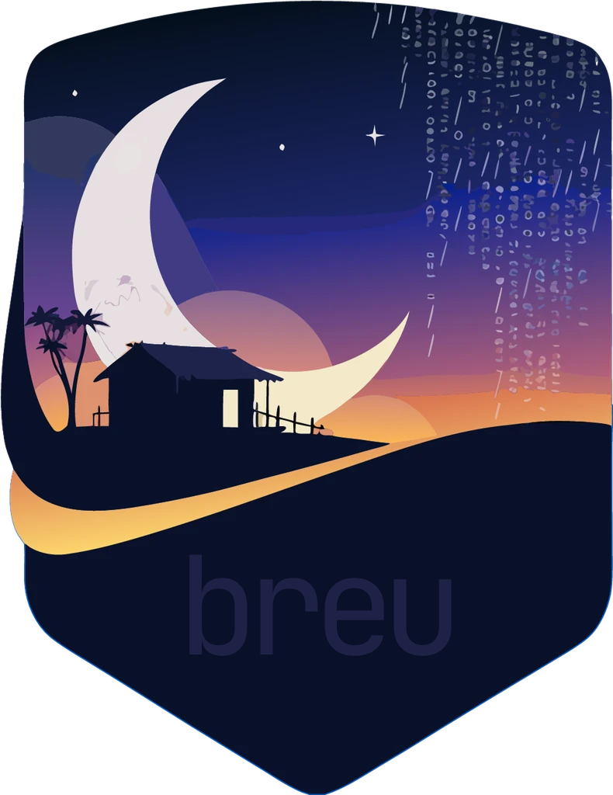
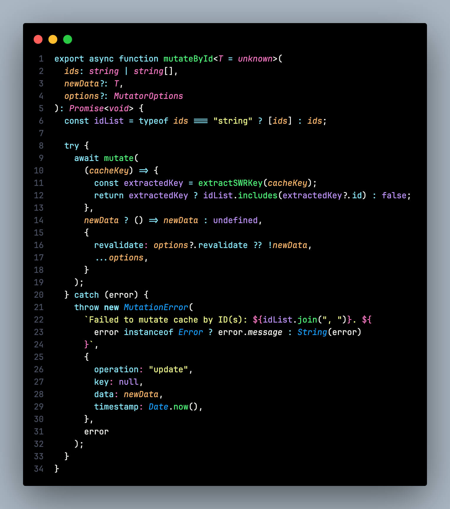
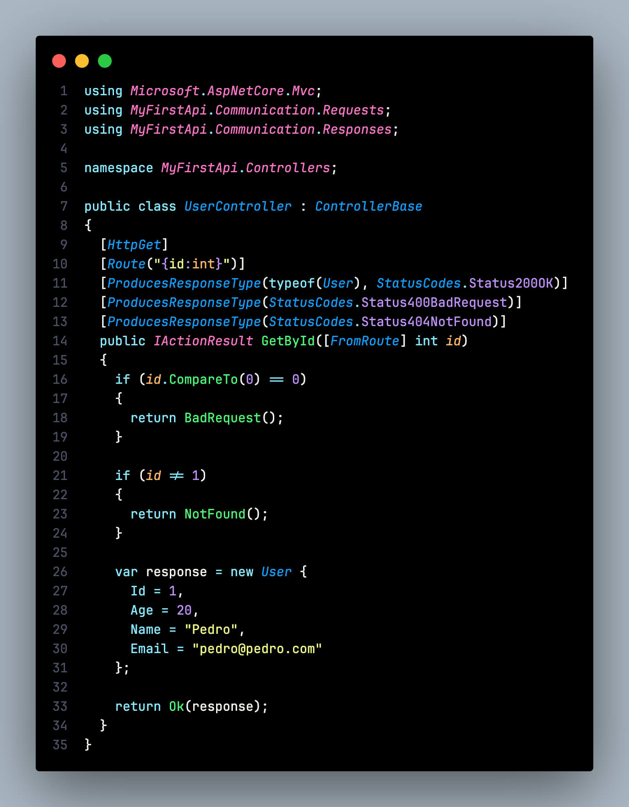

<p align="center">
  
</p>

# Breu

A dark theme for Visual Studio Code with a true `#000000` black background.

<p align="center">
  <a href="https://marketplace.visualstudio.com/items?itemName=pedroab0.breu">
</p>

## Screenshots

### TypeScript



### C#



## More Language Samples

Explore additional language examples at [VS Code Themes](https://vscodethemes.com/e/pedroab0.breu/breu).

## Installation

### Quick Install (NPX)

Install Breu interactively across any of your tools with a single command:

```bash
npx @pedroab0/breu
```

The interactive menu detects your installed tools and lets you choose which ones to configure:

```text
? Which tools would you like to install Breu for?
  (Use ↑/↓ to navigate, Space to toggle, 'a' to toggle all, Enter to confirm)

❯ [✔] VS Code / VSCodium (code CLI detected)
  [✔] Warp Terminal (~/.warp detected)
  [✔] Zsh (Prompt & Syntax Highlighting) (~/.zshrc detected)
  [✔] Gemini CLI (~/.gemini detected)
  [ ] OpenCode (not detected)
```

You can also run non-interactively:

```bash
npx @pedroab0/breu --all           # Install to all detected tools
npx @pedroab0/breu --tools=warp,zsh # Install to specific tools
```

### VS Code Marketplace

1. Open **Extensions** sidebar (`Cmd+Shift+X`)
2. Search for `Breu`
3. Click **Install**
4. Go to **Preferences > Color Theme** and select **Breu**

### Open VSX (VSCodium)

1. Open **Extensions** sidebar
2. Search for `Breu`
3. Click **Install**
4. Select **Breu** from Color Theme

### Manual Installation

**VS Code:**

```bash
git clone https://github.com/pedroab0/breu.git ~/.vscode/extensions/pedroab0.breu
```

**VSCodium:**

```bash
git clone https://github.com/pedroab0/breu.git ~/.vscode-oss/extensions/pedroab0.breu
```

Restart your editor and select the theme.

### Warp Terminal

```bash
mkdir -p ~/.warp/themes
cp themes/breu-warp.yaml ~/.warp/themes/breu.yaml
```

Open Warp and go to **Settings > Appearance > Current Theme**, then select **Breu**.

#### Building from source

```bash
npm run build:warp
# output: themes/breu-warp.yaml
```

### Zsh Theme

The Zsh theme features a clean prompt with directory info, git status, and a success/failure indicator.

#### Option 1: Manual installation

1. Copy the theme file to your home directory:
   ```bash
   cp themes/breu.zsh-theme ~/.breu.zsh-theme
   ```
2. Source it in your `~/.zshrc`:
   ```bash
   source ~/.breu.zsh-theme
   ```

#### Option 2: Oh My Zsh

1. Copy the theme to the custom themes directory:
   ```bash
   mkdir -p ~/.oh-my-zsh/custom/themes
   cp themes/breu.zsh-theme ~/.oh-my-zsh/custom/themes/breu.zsh-theme
   ```
2. Set the theme in your `~/.zshrc`:
   ```zsh
   ZSH_THEME="breu"
   ```

#### Syntax Highlighting (Optional)

If you have [zsh-syntax-highlighting](https://github.com/zsh-users/zsh-syntax-highlighting) installed, you can apply the Breu palette to it:

1. Copy the syntax theme to your home directory:
   ```bash
   cp themes/breu-zsh-syntax.zsh ~/.breu-zsh-syntax.zsh
   ```
2. Source it in your `~/.zshrc` *after* the plugin is loaded:
   ```bash
   source ~/.breu-zsh-syntax.zsh
   ```

#### Building from source

```bash
npm run build:zsh
# output: themes/breu.zsh-theme

npm run build:zsh-syntax
# output: themes/breu-zsh-syntax.zsh
```

### Gemini CLI

There are two ways to install the theme. See the [Gemini CLI custom themes docs](https://geminicli.com/docs/cli/themes/#custom-color-themes) for more details.

#### Option 1: [Load from a file](https://geminicli.com/docs/cli/themes/#loading-themes-from-a-file)

Copy the theme file to your home directory:

```bash
cp themes/breu-gemini.json ~/.gemini/
```

Then set the absolute path in `~/.gemini/settings.json`:

```json
{
  "ui": {
    "theme": "/Users/<your-username>/.gemini/breu-gemini.json"
  }
}
```

#### Option 2: [Define inline in settings](https://geminicli.com/docs/cli/themes/#how-to-define-a-custom-theme)

Add the theme directly to your `~/.gemini/settings.json`:

```json
{
  "ui": {
    "theme": "Breu",
    "customThemes": {
      "Breu": {
        "name": "Breu",
        "type": "dark",
        "Background": "#000000",
        "Foreground": "#F8F8F2",
        "LightBlue": "#5CB8FF",
        "AccentBlue": "#179FFF",
        "AccentPurple": "#BD93F9",
        "AccentCyan": "#8BE9FD",
        "AccentGreen": "#50FA7B",
        "AccentYellow": "#F1FA8C",
        "AccentRed": "#FF5555",
        "Comment": "#6272A4",
        "Gray": "#9DA5B4",
        "DiffAdded": "#50FA7B",
        "DiffRemoved": "#FF5555",
        "GradientColors": ["#BD93F9", "#179FFF", "#8BE9FD"]
      }
    }
  }
}
```

You can also switch themes inside Gemini CLI using the `/theme` command.

#### Building from source

```bash
npm run build:gemini
# output: themes/breu-gemini.json
```

### OpenCode

[OpenCode](https://opencode.ai) is an AI-powered terminal coding assistant. Breu ships a ready-made theme file that matches the color palette exactly.

#### Requirements

Your terminal must support **truecolor** (24-bit color).

```bash
echo $COLORTERM   # should print: truecolor
```

If it does not, add `export COLORTERM=truecolor` to your shell profile.

#### Installation

**Option A — User-wide (applies to every project)**

```bash
mkdir -p ~/.config/opencode/themes
cp themes/breu-opencode.json ~/.config/opencode/themes/breu.json
```

**Option B — Project-specific**

```bash
mkdir -p .opencode/themes
cp themes/breu-opencode.json .opencode/themes/breu.json
```

#### Activation

Either run the `/theme` command inside OpenCode and select **breu**, or set it in your configuration file (`~/.config/opencode/opencode.json` or `.opencode/opencode.json`):

```json
{
  "$schema": "https://opencode.ai/config.json",
  "theme": "breu"
}
```

#### Building from source

```bash
npm run build:opencode
# output: themes/breu-opencode.json
```

## Color Palette

| Color | Hex | Usage |
|-------|-----|-------|
|  | `#000000` | Editor background |
|  | `#F8F8F2` | Default text |
|  | `#8BE9FD` | Keywords, storage, JSON keys |
|  | `#50FA7B` | Functions, attributes |
|  | `#FFB86C` | Parameters, warnings |
|  | `#FF79C6` | Tags, types, separators |
|  | `#BD93F9` | Constants, `this`/`self` |
|  | `#FF5555` | Errors, deletions |
|  | `#F1FA8C` | Strings, quotes |
|  | `#179FFF` | Classes, components, info |
|  | `#6272A4` | Comments, muted text |

## Features

- True black (`#000000`) background for OLED displays
- Multi-platform themes (VS Code, Warp, Gemini CLI, Zsh, OpenCode)
- Full terminal ANSI color support
- Semantic highlighting enabled
- Comprehensive syntax highlighting for 15+ languages
- Debug panel theming
- Git decoration colors

## Documentation

See [THEME.md](THEME.md) for complete color documentation.

## License

[MIT](LICENSE) © Pedro Barbosa
